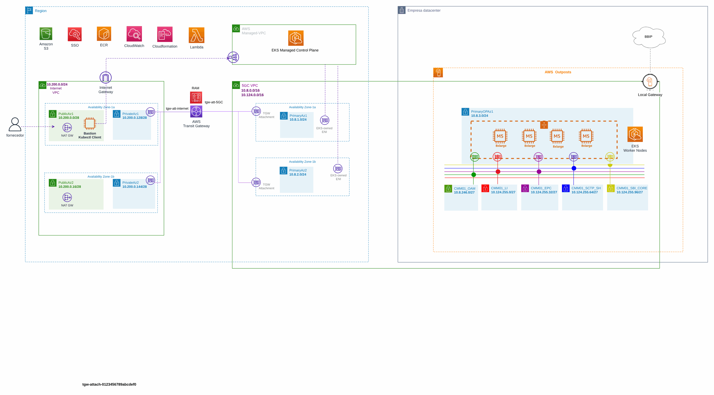

# EKS para funções de core 5G

> CCoE, landing zone e plataforma de uma operadora de telecom (2025-2026)

Cluster EKS para funções de rede de core 5G, arquitetura alvo e fluxo de deploy.

## Desenho

Fonte editável: [`desenho.drawio`](desenho.drawio). Abra no draw.io para navegar pelas páginas.

### 1. AMF_Cluster



## Componentes identificados no desenho

- Amazon EKS → módulo [`aws/eks-cluster`](../../../../aws/eks-cluster)
- Amazon S3 → módulo [`aws/s3-bucket`](../../../../aws/s3-bucket)
- AWS Lambda → módulo [`aws/lambda-function`](../../../../aws/lambda-function)
- Amazon VPC → módulo [`aws/vpc`](../../../../aws/vpc)
- Transit Gateway → módulo [`aws/transit-gateway-attachment`](../../../../aws/transit-gateway-attachment)
- Amazon ECR → módulo [`aws/ecr`](../../../../aws/ecr)
- Amazon CloudWatch → módulo [`aws/cloudwatch-logs`](../../../../aws/cloudwatch-logs)
- IAM Identity Center → módulo [`aws/identity-center-permission-set`](../../../../aws/identity-center-permission-set)

## Automação pronta

A pasta [`terraform/`](terraform) compõe estes módulos do catálogo, na ordem de dependência:

1. [`aws/kms-key`](../../../../aws/kms-key): Chave KMS (CMK) da plataforma
1. [`aws/vpc`](../../../../aws/vpc): VPC em três camadas
1. [`aws/eks-cluster`](../../../../aws/eks-cluster): Cluster EKS privado
1. [`aws/transit-gateway-attachment`](../../../../aws/transit-gateway-attachment): Attachment de VPC ao Transit Gateway
1. [`aws/ecr`](../../../../aws/ecr): Repositórios ECR com scan, KMS e retenção

As saídas de um módulo alimentam o próximo (por exemplo, `module.vpc.private_subnet_ids` e `module.kms_key.key_arn`),
então não há IDs fixos entre camadas.

### Como executar

```bash
cd labs/arquiteturas/telecom/eks-core-5g/terraform
# ajuste locals.tf (prefixo, região, tags) e backend.tf (bucket/conta de state)
terraform init
terraform plan -out tfplan
terraform apply tfplan
```

Valores de exemplo (contas, IDs, domínios) são fictícios; troque pelos do seu ambiente antes do apply.
