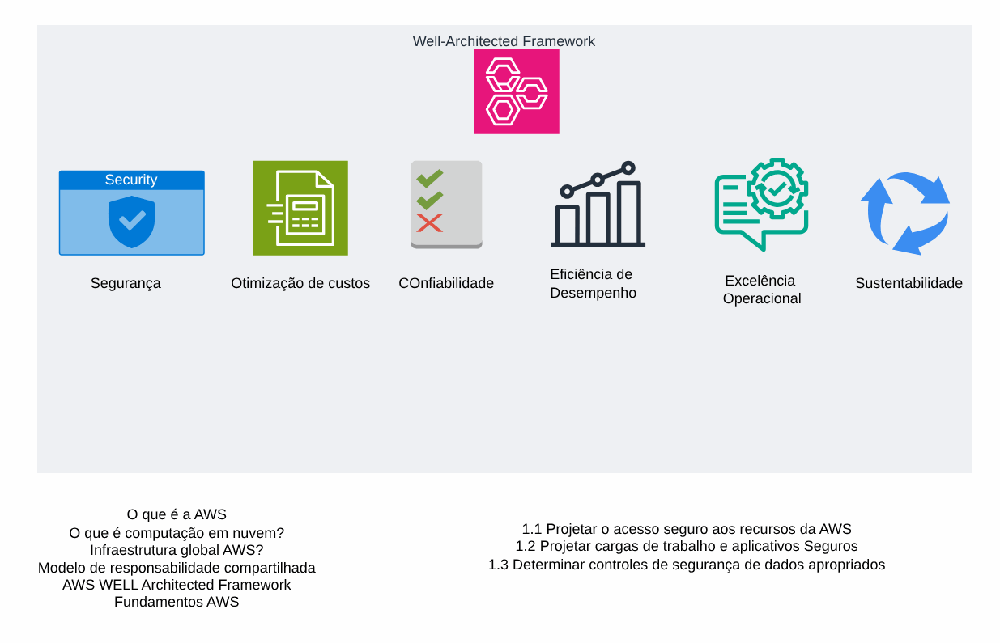
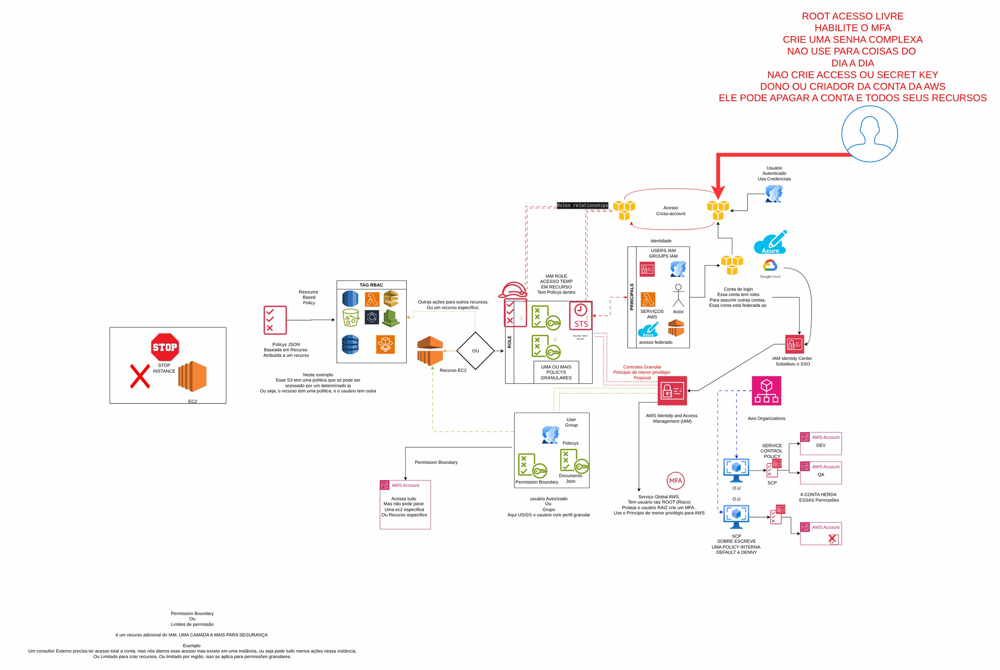
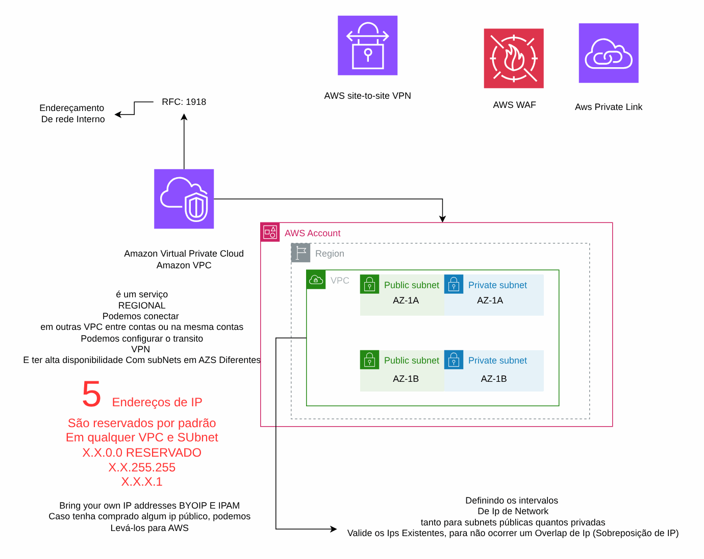
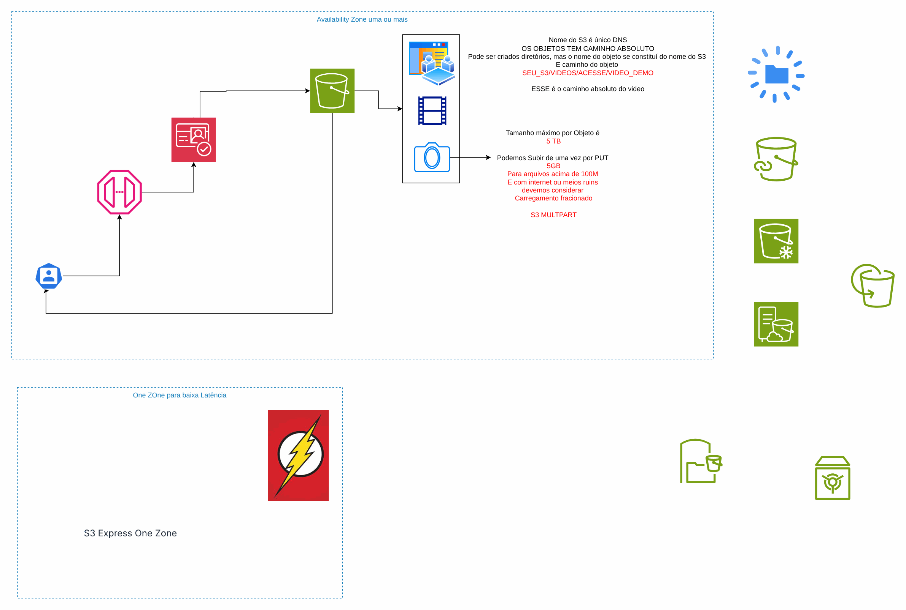
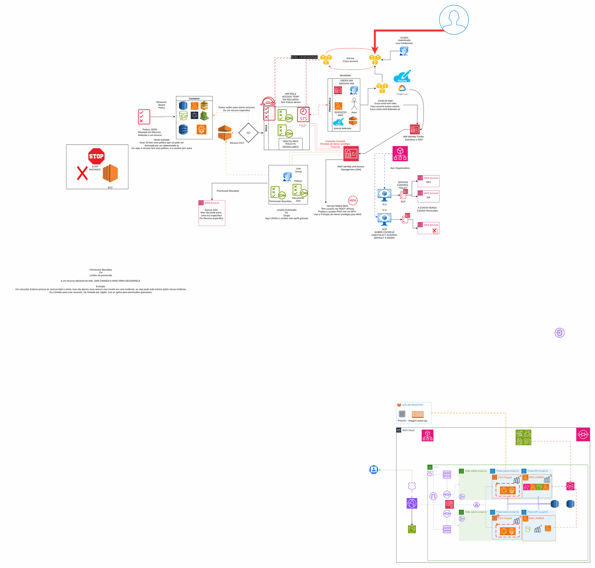
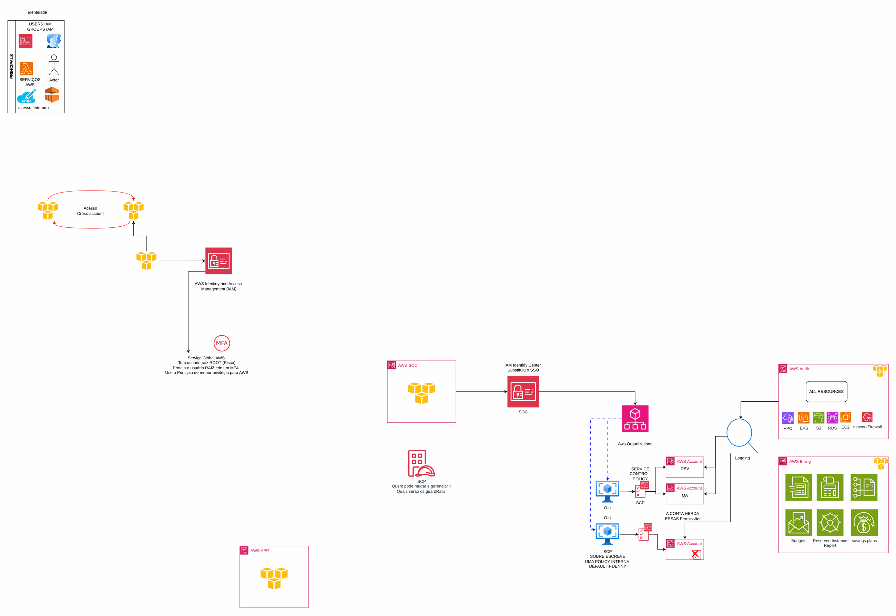
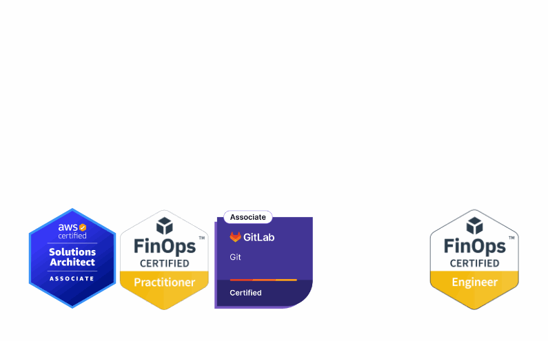

# Fundamentos de AWS para o time

> CCoE, landing zone e plataforma de uma operadora de telecom (2025-2026)

Material de capacitação: cloud, Well-Architected, IAM, VPC, computação, S3 e guardrails.

## Desenho

Fonte editável: [`desenho.drawio`](desenho.drawio). Abra no draw.io para navegar pelas páginas.

### 1. O que é CLoud?


### 2. WELL-Architected



### 3. IAM



### 4. VPC



### 5. S3



### 6. Resumo



### 7. Guard-rails



### 8. assinatura



## Componentes identificados no desenho

- Amazon EKS → módulo [`aws/eks-cluster`](../../../../aws/eks-cluster)
- Amazon ECS/Fargate: serviços em ECS/Fargate ficam no repositório da aplicação (task definition + service); a rede, o ECR e o banco vêm daqui
- Amazon RDS → módulo [`aws/rds-instance`](../../../../aws/rds-instance)
- Amazon S3 → módulo [`aws/s3-bucket`](../../../../aws/s3-bucket)
- Amazon SQS → módulo [`aws/sqs-queue`](../../../../aws/sqs-queue)
- Amazon SNS → módulo [`aws/sns-topic`](../../../../aws/sns-topic)
- AWS Lambda → módulo [`aws/lambda-function`](../../../../aws/lambda-function)
- Amazon Cognito → módulo [`aws/cognito-user-pool`](../../../../aws/cognito-user-pool)
- Amazon CloudFront → módulo [`aws/cloudfront-spa`](../../../../aws/cloudfront-spa)
- Amazon VPC → módulo [`aws/vpc`](../../../../aws/vpc)
- VPN Site-to-Site → módulo [`aws/vpn-site-to-site`](../../../../aws/vpn-site-to-site)
- Route 53 → módulo [`aws/route53-private-zone`](../../../../aws/route53-private-zone)
- Amazon ECR → módulo [`aws/ecr`](../../../../aws/ecr)
- Amazon EventBridge → módulo [`aws/eventbridge-bus-sqs`](../../../../aws/eventbridge-bus-sqs)
- AWS Organizations / SCP → módulo [`aws/organizations-scp`](../../../../aws/organizations-scp)
- VPC Endpoints → módulo [`aws/vpc-endpoints`](../../../../aws/vpc-endpoints)
- AWS WAF: o Web ACL é passado por ARN para o CloudFront (`web_acl_id`) ou associado ao ALB
- IAM Identity Center → módulo [`aws/identity-center-permission-set`](../../../../aws/identity-center-permission-set)

## Automação pronta

A pasta [`terraform/`](terraform) compõe estes módulos do catálogo, na ordem de dependência:

1. [`aws/organizations-scp`](../../../../aws/organizations-scp): Organizations: OUs, SCPs e Tag Policy
1. [`aws/iam-group`](../../../../aws/iam-group): Grupo IAM com MFA obrigatório
1. [`aws/vpc`](../../../../aws/vpc): VPC em três camadas
1. [`aws/s3-bucket`](../../../../aws/s3-bucket): Bucket S3 seguro por padrão

As saídas de um módulo alimentam o próximo (por exemplo, `module.vpc.private_subnet_ids` e `module.kms_key.key_arn`),
então não há IDs fixos entre camadas.

### Como executar

```bash
cd labs/arquiteturas/telecom/fundamentos-aws/terraform
# ajuste locals.tf (prefixo, região, tags) e backend.tf (bucket/conta de state)
terraform init
terraform plan -out tfplan
terraform apply tfplan
```

Valores de exemplo (contas, IDs, domínios) são fictícios; troque pelos do seu ambiente antes do apply.
