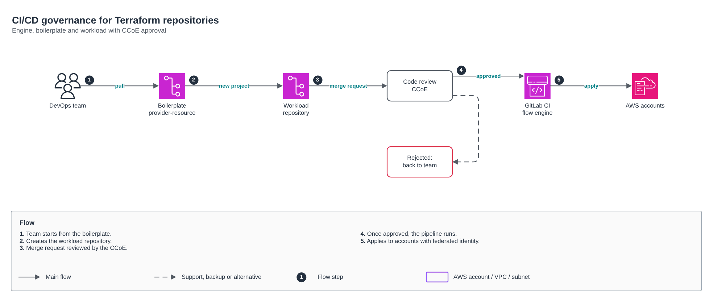

# CI/CD governance for Terraform repositories

[Português](README.md) · **English**

> CCoE, landing zone and platform of a telecom operator (2025-2026)

Boilerplate, CCoE-reviewed merge requests and apply with federated identity.

## Diagram

Editable source: [`desenho.drawio`](desenho.drawio), with pages in Portuguese and English. Open it in draw.io to browse.

The original drawing, anonymized, is kept in [`original/`](original) for reference.

### CI/CD governance for Terraform repositories



## Components found in the diagram

- Amazon VPC → module [`aws/vpc`](../../../../aws/vpc)

## Ready-made automation

The [`terraform/`](terraform) folder composes these catalog modules, in dependency order:

1. [`aws/tf-backend-bootstrap`](../../../../aws/tf-backend-bootstrap): Bootstrap do backend S3 do Terraform
1. [`aws/iam-github-oidc`](../../../../aws/iam-github-oidc): GitHub Actions -> AWS por OIDC

One module's outputs feed the next (for example `module.vpc.private_subnet_ids` and `module.kms_key.key_arn`), so there are no hard-coded IDs between layers.

### How to run

```bash
cd labs/arquiteturas/telecom/governanca-ci-cd-repos/terraform
# adjust locals.tf (prefix, region, tags) and backend.tf (state bucket/account)
terraform init
terraform plan -out tfplan
terraform apply tfplan
```

Sample values (accounts, IDs, domains) are fictitious; replace them with your own before applying.

## FinOps for this architecture

What weighs most on the bill for this solution and the lever for each item:

| Component | Cost driver | Lever |
|---|---|---|
| Environment | resources without an owner and non-production environments running 24/7 | mandatory tags and after-hours shutdown |

The FinOps cycle (inform, optimize, operate) is in the [FinOps process](../../telecom/processo-finops) lab.
To close the loop for this solution, also apply: [`aws/tag-compliance`](../../../../aws/tag-compliance), [`aws/finops-cost-report`](../../../../aws/finops-cost-report), [`aws/cur-focus-export`](../../../../aws/cur-focus-export), [`aws/instance-scheduler`](../../../../aws/instance-scheduler).
