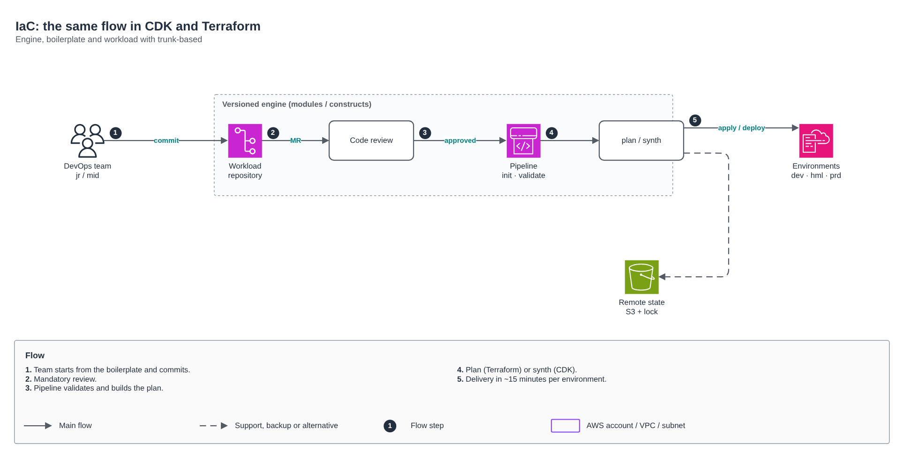

# IaC: CDK vs Terraform

[Português](README.md) · **English**

> CCoE, landing zone and platform of a telecom operator (2025-2026)

The same trunk-based flow in CDK and Terraform, from engine to workload.

## Diagram

Editable source: [`desenho.drawio`](desenho.drawio), with pages in Portuguese and English. Open it in draw.io to browse.

The original drawing, anonymized, is kept in [`original/`](original) for reference.

### IaC: the same flow in CDK and Terraform



## Components found in the diagram

- Amazon S3 → module [`aws/s3-bucket`](../../../../aws/s3-bucket)
- Amazon VPC → module [`aws/vpc`](../../../../aws/vpc)

## Ready-made automation

The [`terraform/`](terraform) folder composes these catalog modules, in dependency order:

1. [`aws/tf-backend-bootstrap`](../../../../aws/tf-backend-bootstrap): Bootstrap do backend S3 do Terraform
1. [`aws/vpc`](../../../../aws/vpc): VPC em três camadas

One module's outputs feed the next (for example `module.vpc.private_subnet_ids` and `module.kms_key.key_arn`), so there are no hard-coded IDs between layers.

### How to run

```bash
cd labs/arquiteturas/telecom/iac-cdk-x-terraform/terraform
# adjust locals.tf (prefix, region, tags) and backend.tf (state bucket/account)
terraform init
terraform plan -out tfplan
terraform apply tfplan
```

Sample values (accounts, IDs, domains) are fictitious; replace them with your own before applying.

## FinOps for this architecture

What weighs most on the bill for this solution and the lever for each item:

| Component | Cost driver | Lever |
|---|---|---|
| [`aws/vpc`](../../../../aws/vpc) | NAT Gateway per AZ and the traffic it processes | a single NAT in DEV and VPC endpoints for S3/ECR to keep traffic off the NAT |

The FinOps cycle (inform, optimize, operate) is in the [FinOps process](../../telecom/processo-finops) lab.
To close the loop for this solution, also apply: [`aws/tag-compliance`](../../../../aws/tag-compliance), [`aws/finops-cost-report`](../../../../aws/finops-cost-report), [`aws/cur-focus-export`](../../../../aws/cur-focus-export), [`aws/instance-scheduler`](../../../../aws/instance-scheduler).
