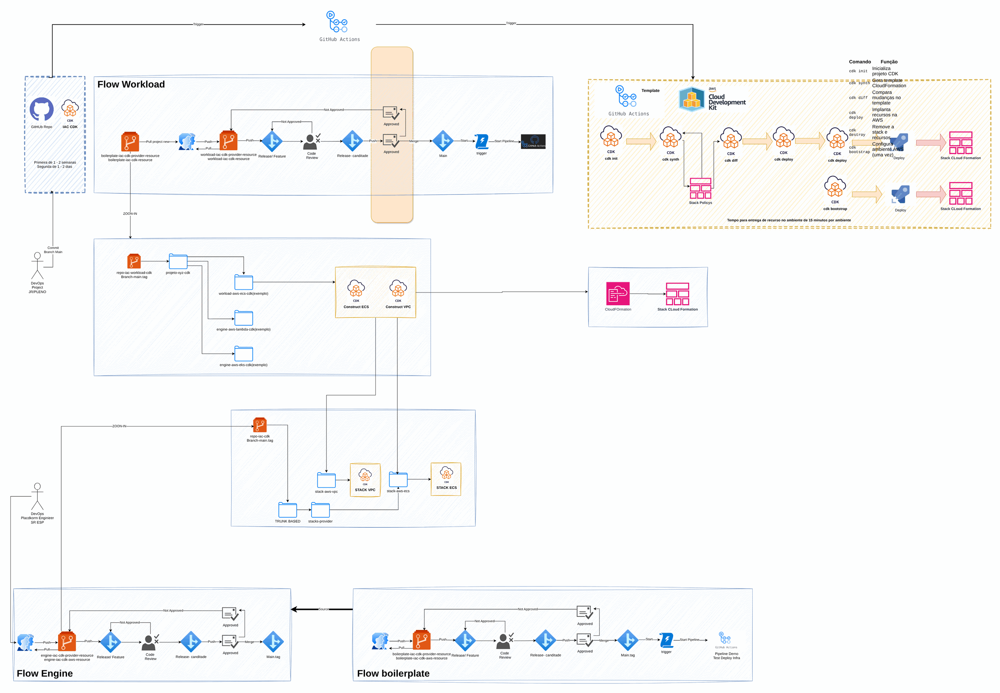
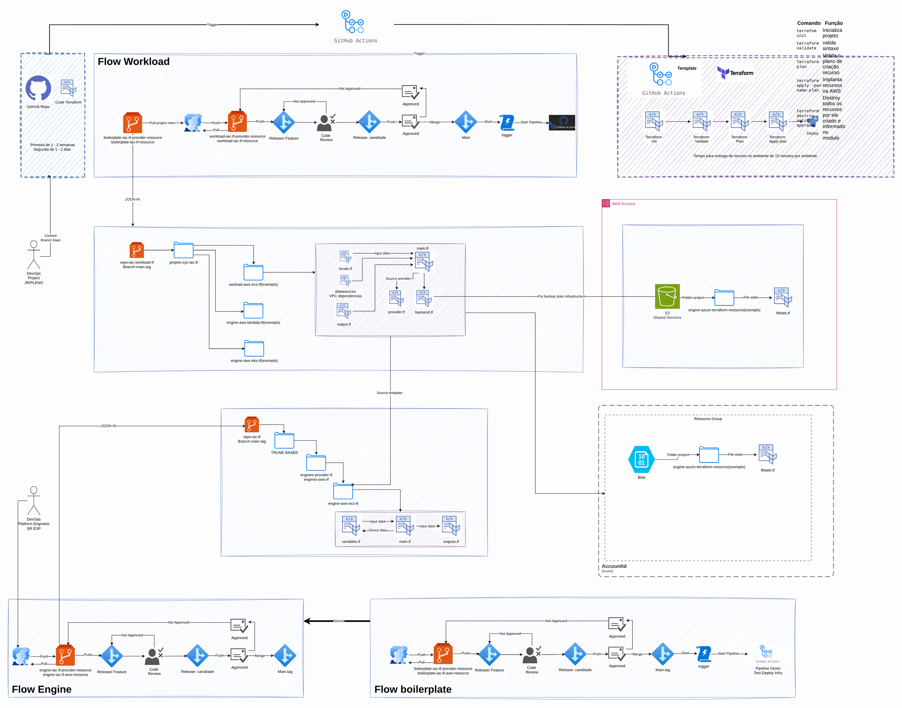
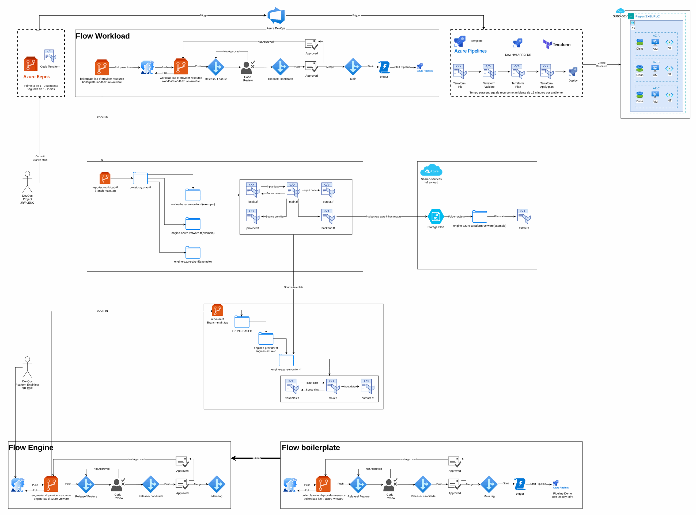

# IaC: CDK x Terraform

> CCoE, landing zone e plataforma de uma operadora de telecom (2025-2026)

Comparação prática entre CDK e Terraform para o mesmo ambiente.

## Desenho

Fonte editável: [`desenho.drawio`](desenho.drawio). Abra no draw.io para navegar pelas páginas.

### 1. CDK



### 2. terrafrom



### 3. Page-1



## Componentes identificados no desenho

- Amazon ECS/Fargate: serviços em ECS/Fargate ficam no repositório da aplicação (task definition + service); a rede, o ECR e o banco vêm daqui
- Amazon S3 → módulo [`aws/s3-bucket`](../../../../aws/s3-bucket)
- Amazon VPC → módulo [`aws/vpc`](../../../../aws/vpc)

## Automação pronta

A pasta [`terraform/`](terraform) compõe estes módulos do catálogo, na ordem de dependência:

1. [`aws/tf-backend-bootstrap`](../../../../aws/tf-backend-bootstrap): Bootstrap do backend S3 do Terraform
1. [`aws/vpc`](../../../../aws/vpc): VPC em três camadas

As saídas de um módulo alimentam o próximo (por exemplo, `module.vpc.private_subnet_ids` e `module.kms_key.key_arn`),
então não há IDs fixos entre camadas.

### Como executar

```bash
cd labs/arquiteturas/telecom/iac-cdk-x-terraform/terraform
# ajuste locals.tf (prefixo, região, tags) e backend.tf (bucket/conta de state)
terraform init
terraform plan -out tfplan
terraform apply tfplan
```

Valores de exemplo (contas, IDs, domínios) são fictícios; troque pelos do seu ambiente antes do apply.
