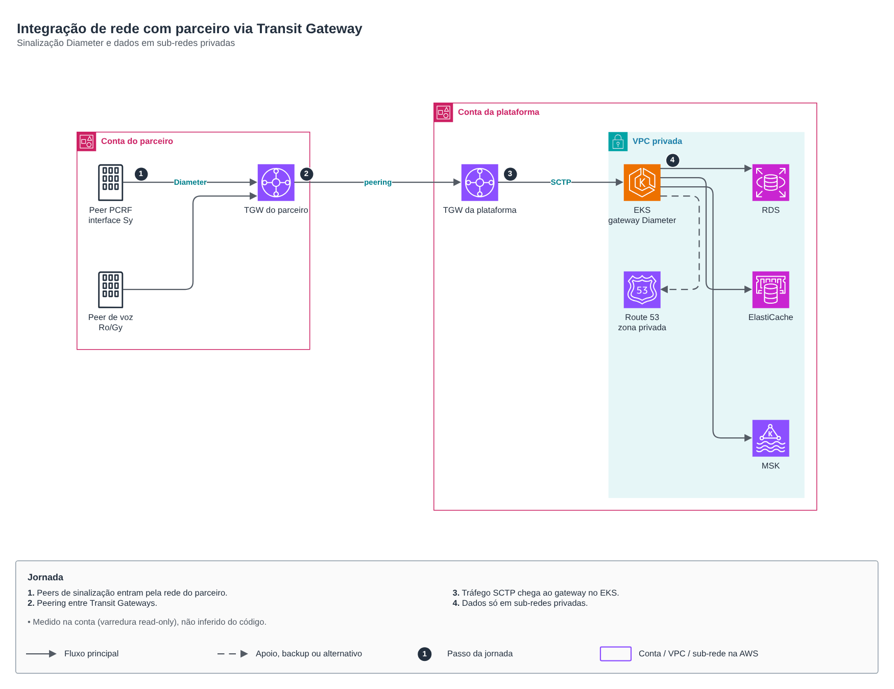

# Integração de rede com parceiro

**Português** · [English](README.en.md)

> CCoE, landing zone e plataforma de uma operadora de telecom (2025-2026)

Peering de Transit Gateways para sinalização Diameter e dados em sub-redes privadas.

## Desenho

Fonte editável: [`desenho.drawio`](desenho.drawio), com páginas em português e em inglês. Abra no draw.io para navegar.

O desenho original, anonimizado, está em [`original/`](original) como referência.

### Integração de rede com parceiro via Transit Gateway



## Componentes identificados no desenho

- Amazon EKS → módulo [`aws/eks-cluster`](../../../../aws/eks-cluster)
- Amazon RDS → módulo [`aws/rds-instance`](../../../../aws/rds-instance)
- ElastiCache → módulo [`aws/elasticache-redis`](../../../../aws/elasticache-redis)
- Amazon VPC → módulo [`aws/vpc`](../../../../aws/vpc)
- Transit Gateway → módulo [`aws/transit-gateway-attachment`](../../../../aws/transit-gateway-attachment)
- Route 53 → módulo [`aws/route53-private-zone`](../../../../aws/route53-private-zone)
- Amazon MSK → módulo [`aws/msk-kafka`](../../../../aws/msk-kafka)

## Automação pronta

A pasta [`terraform/`](terraform) compõe estes módulos do catálogo, na ordem de dependência:

1. [`aws/kms-key`](../../../../aws/kms-key): Chave KMS (CMK) da plataforma
1. [`aws/vpc`](../../../../aws/vpc): VPC em três camadas
1. [`aws/transit-gateway-attachment`](../../../../aws/transit-gateway-attachment): Attachment de VPC ao Transit Gateway
1. [`aws/route53-private-zone`](../../../../aws/route53-private-zone): Zona Route 53 privada multi-conta
1. [`aws/msk-kafka`](../../../../aws/msk-kafka): Amazon MSK com SASL/IAM
1. [`aws/elasticache-redis`](../../../../aws/elasticache-redis): ElastiCache Valkey/Redis cifrado
1. [`aws/rds-instance`](../../../../aws/rds-instance): RDS MySQL/PostgreSQL privado

As saídas de um módulo alimentam o próximo (por exemplo, `module.vpc.private_subnet_ids` e `module.kms_key.key_arn`), então não há IDs fixos entre camadas.

### Como executar

```bash
cd labs/arquiteturas/telecom/integracao-rede-parceiro/terraform
# ajuste locals.tf (prefixo, região, tags) e backend.tf (bucket/conta de state)
terraform init
terraform plan -out tfplan
terraform apply tfplan
```

Valores de exemplo (contas, IDs, domínios) são fictícios; troque pelos do seu ambiente antes do apply.

## FinOps desta arquitetura

O que mais pesa na conta desta solução e a alavanca para cada item:

| Componente | O que pesa | Alavanca |
|---|---|---|
| [`aws/rds-instance`](../../../../aws/rds-instance) | classe da instância e Multi-AZ do RDS | dimensionar pela métrica real, reserva para PRD e parar HML/DEV fora do horário |
| [`aws/msk-kafka`](../../../../aws/msk-kafka) | brokers e armazenamento do MSK | retenção por tópico, tiered storage e brokers Graviton |
| [`aws/vpc`](../../../../aws/vpc) | NAT Gateway por AZ e tráfego que passa por ele | um NAT só em DEV e VPC endpoints para S3/ECR tirarem tráfego do NAT |
| [`aws/transit-gateway-attachment`](../../../../aws/transit-gateway-attachment) | attachments e GB processados no Transit Gateway | consolidar attachments e manter tráfego de alto volume fora do TGW |
| [`aws/elasticache-redis`](../../../../aws/elasticache-redis) | nós do ElastiCache ligados 24h | tipo de nó menor com Graviton e reserva para PRD |
| [`aws/kms-key`](../../../../aws/kms-key) | chaves KMS por mês e chamadas de API | bucket keys no S3 reduzem chamadas ao KMS |
| [`aws/route53-private-zone`](../../../../aws/route53-private-zone) | zonas hospedadas e consultas | consolidar zonas privadas compartilhadas entre VPCs |

O ciclo de FinOps (informar, otimizar, operar) está no lab [Processo de FinOps](../../telecom/processo-finops).
Para fechar o ciclo nesta solução, aplique também: [`aws/tag-compliance`](../../../../aws/tag-compliance), [`aws/finops-cost-report`](../../../../aws/finops-cost-report), [`aws/cur-focus-export`](../../../../aws/cur-focus-export), [`aws/instance-scheduler`](../../../../aws/instance-scheduler).
