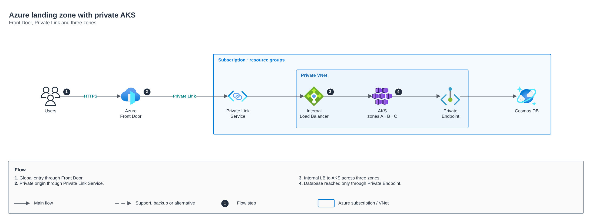

# Azure landing zone with private AKS

[Português](README.md) · **English**

> CCoE, landing zone and platform of a telecom operator (2025-2026)

Front Door, Private Link Service, AKS across three zones and a database through Private Endpoint.

## Diagram

Editable source: [`desenho.drawio`](desenho.drawio), with pages in Portuguese and English. Open it in draw.io to browse.

The original drawing, anonymized, is kept in [`original/`](original) for reference.

### Azure landing zone with private AKS

## Automation

This drawing describes process, governance or network outside the scope of the catalog modules; it is a reference for decisions and has no automation of its own.

## FinOps for this architecture

What weighs most on the bill for this solution and the lever for each item:

| Component | Cost driver | Lever |
|---|---|---|
| Environment | subscriptions without an owner and idle VMs | tags by policy, Cost Management budgets and Advisor |

The FinOps cycle (inform, optimize, operate) is in the [FinOps process](../../telecom/processo-finops) lab.
