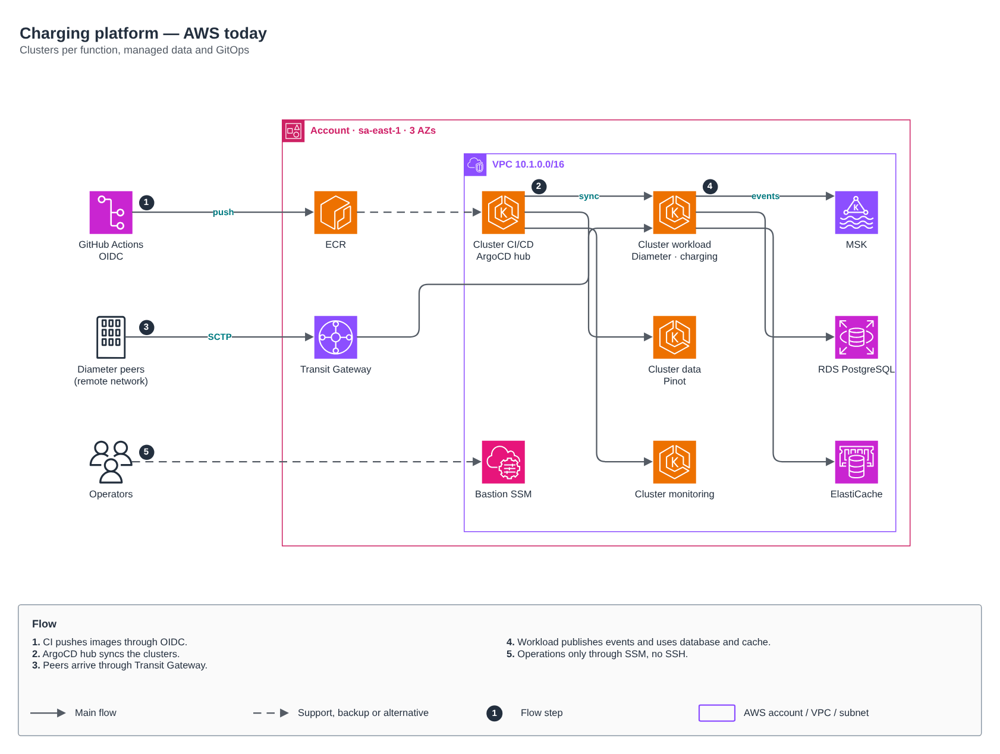
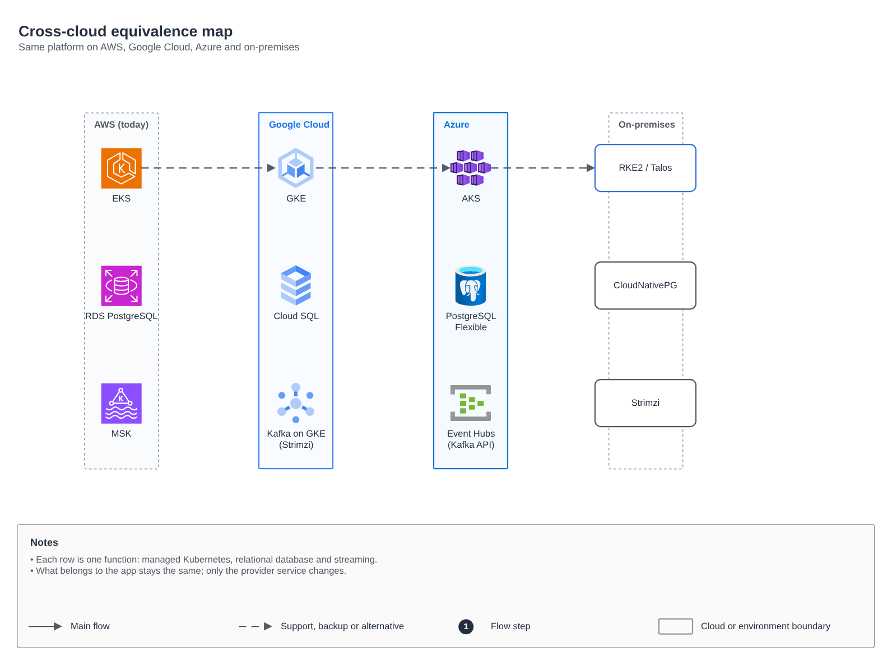

# Multicloud charging platform

[Português](README.md) · **English**

> CCoE, landing zone and platform of a telecom operator (2025-2026)

The platform today on AWS and the equivalence map to Google Cloud, Azure and on-premises.

## Diagram

Editable source: [`desenho.drawio`](desenho.drawio), with pages in Portuguese and English. Open it in draw.io to browse.

The original drawing, anonymized, is kept in [`original/`](original) for reference.

### Charging platform — AWS today



### Cross-cloud equivalence map



## Components found in the diagram

- Amazon EKS → module [`aws/eks-cluster`](../../../../aws/eks-cluster)
- Amazon RDS → module [`aws/rds-instance`](../../../../aws/rds-instance)
- ElastiCache → module [`aws/elasticache-redis`](../../../../aws/elasticache-redis)
- Amazon VPC → module [`aws/vpc`](../../../../aws/vpc)
- Transit Gateway → module [`aws/transit-gateway-attachment`](../../../../aws/transit-gateway-attachment)
- Amazon ECR → module [`aws/ecr`](../../../../aws/ecr)
- Amazon MSK → module [`aws/msk-kafka`](../../../../aws/msk-kafka)

## Ready-made automation

The [`terraform/`](terraform) folder composes these catalog modules, in dependency order:

1. [`aws/kms-key`](../../../../aws/kms-key): Chave KMS (CMK) da plataforma
1. [`aws/vpc`](../../../../aws/vpc): VPC em três camadas
1. [`aws/eks-cluster`](../../../../aws/eks-cluster): Cluster EKS privado
1. [`aws/msk-kafka`](../../../../aws/msk-kafka): Amazon MSK com SASL/IAM
1. [`aws/rds-instance`](../../../../aws/rds-instance): RDS MySQL/PostgreSQL privado
1. [`aws/elasticache-redis`](../../../../aws/elasticache-redis): ElastiCache Valkey/Redis cifrado
1. [`aws/transit-gateway-attachment`](../../../../aws/transit-gateway-attachment): Attachment de VPC ao Transit Gateway

One module's outputs feed the next (for example `module.vpc.private_subnet_ids` and `module.kms_key.key_arn`), so there are no hard-coded IDs between layers.

### How to run

```bash
cd labs/arquiteturas/telecom/plataforma-multicloud/terraform
# adjust locals.tf (prefix, region, tags) and backend.tf (state bucket/account)
terraform init
terraform plan -out tfplan
terraform apply tfplan
```

Sample values (accounts, IDs, domains) are fictitious; replace them with your own before applying.

## FinOps for this architecture

What weighs most on the bill for this solution and the lever for each item:

| Component | Cost driver | Lever |
|---|---|---|
| [`aws/eks-cluster`](../../../../aws/eks-cluster) | EKS nodes (EC2) and the per-cluster control plane | node autoscaling (Karpenter/Cluster Autoscaler), Spot for tolerant workloads and Savings Plans for the baseline |
| [`aws/rds-instance`](../../../../aws/rds-instance) | RDS instance class and Multi-AZ | right-size from real metrics, reserve PRD and stop HML/DEV after hours |
| [`aws/msk-kafka`](../../../../aws/msk-kafka) | MSK brokers and storage | per-topic retention, tiered storage and Graviton brokers |
| [`aws/vpc`](../../../../aws/vpc) | NAT Gateway per AZ and the traffic it processes | a single NAT in DEV and VPC endpoints for S3/ECR to keep traffic off the NAT |
| [`aws/transit-gateway-attachment`](../../../../aws/transit-gateway-attachment) | Transit Gateway attachments and processed GB | consolidate attachments and keep high-volume traffic off the TGW |
| [`aws/elasticache-redis`](../../../../aws/elasticache-redis) | ElastiCache nodes running 24/7 | smaller Graviton node type and reservation for PRD |
| [`aws/kms-key`](../../../../aws/kms-key) | KMS keys per month and API calls | S3 bucket keys reduce KMS calls |

The FinOps cycle (inform, optimize, operate) is in the [FinOps process](../../telecom/processo-finops) lab.
To close the loop for this solution, also apply: [`aws/tag-compliance`](../../../../aws/tag-compliance), [`aws/finops-cost-report`](../../../../aws/finops-cost-report), [`aws/cur-focus-export`](../../../../aws/cur-focus-export), [`aws/instance-scheduler`](../../../../aws/instance-scheduler).
