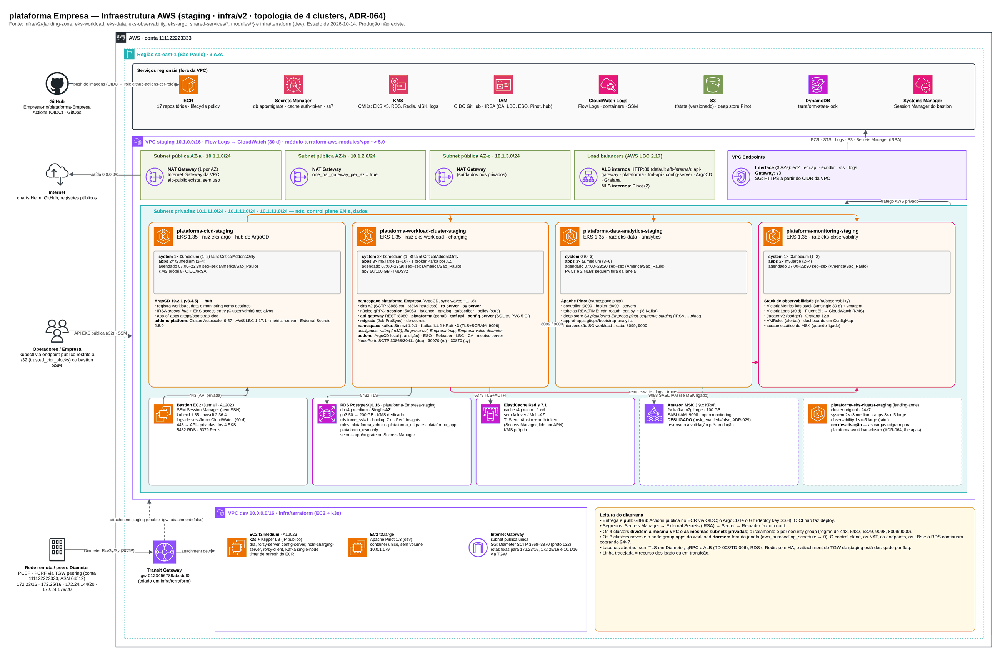
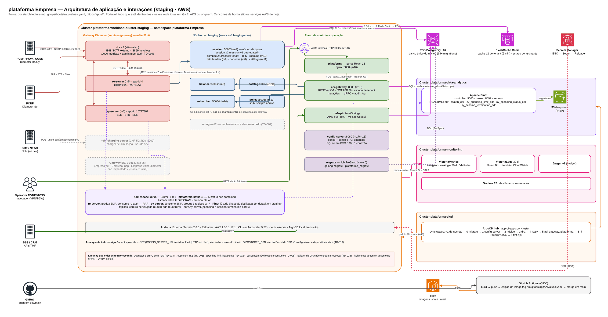
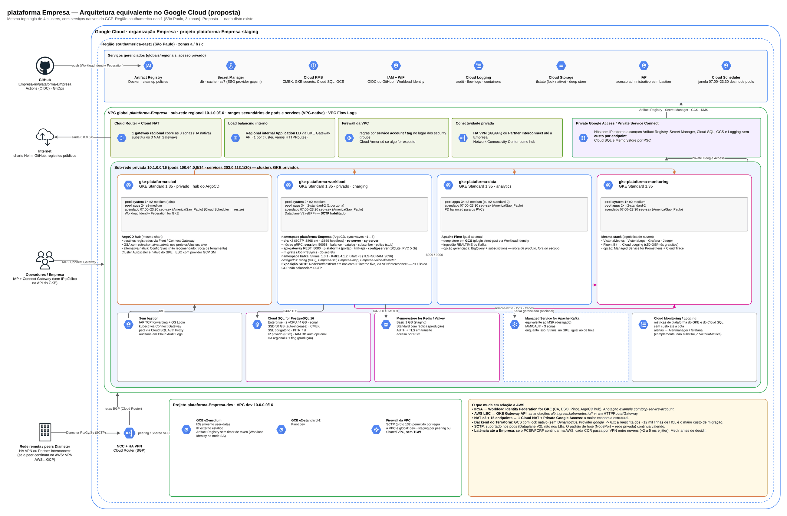
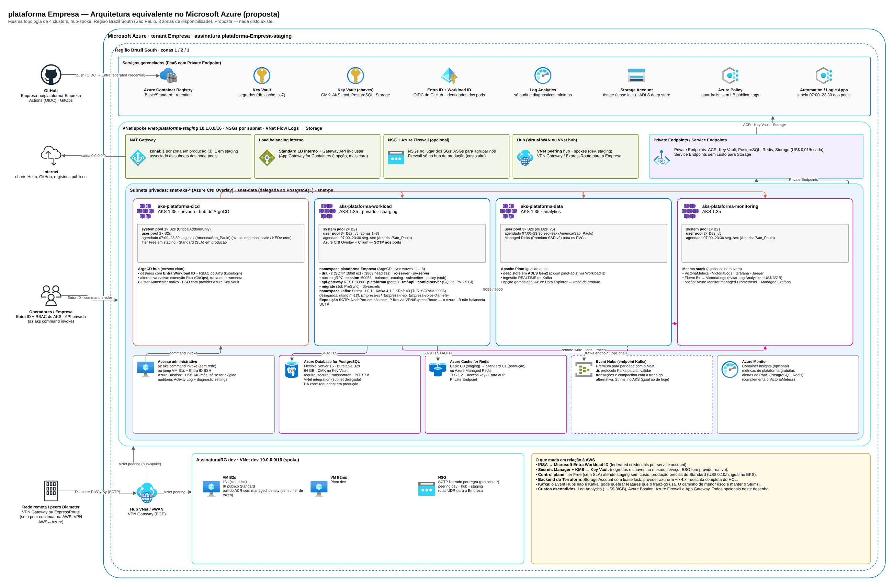
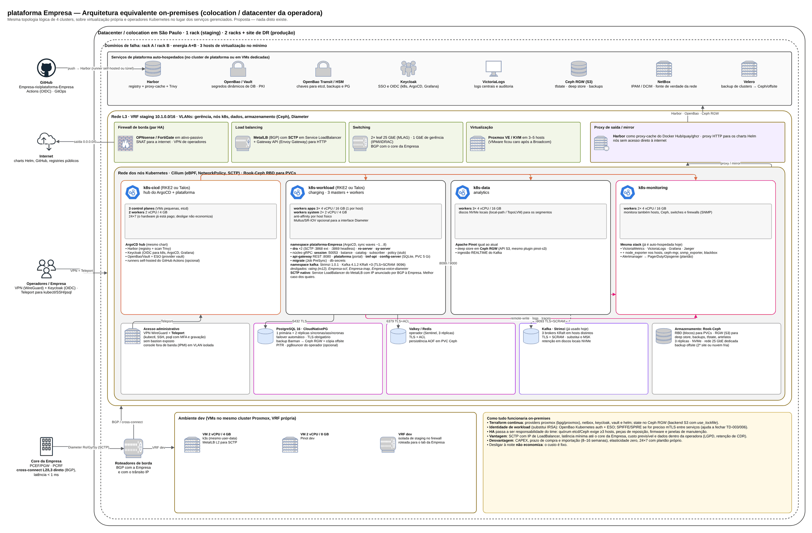
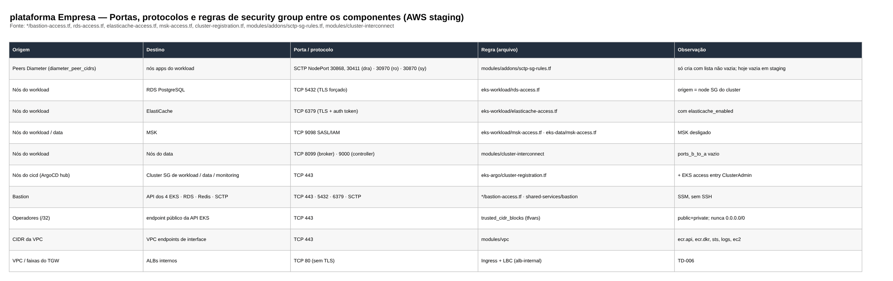
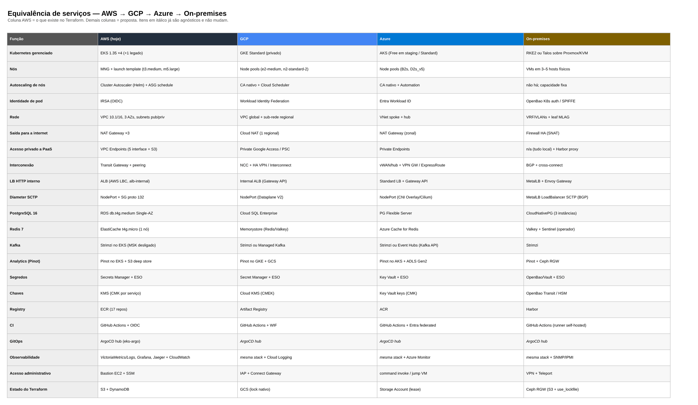

# Plataforma de tarifação multicloud

> CCoE, landing zone e plataforma de uma operadora de telecom (2025-2026)

A mesma plataforma desenhada em AWS, GCP, Azure e on-premises, com componentes da aplicação, fronteiras de rede e mapa de equivalência de serviços.

## Desenho

Fonte editável: [`desenho.drawio`](desenho.drawio). Abra no draw.io para navegar pelas páginas.

### 1. 1 · AWS — Infraestrutura (staging)



### 2. 2 · Aplicação — componentes e fluxos



### 3. 3 · GCP — Arquitetura equivalente



### 4. 4 · Azure — Arquitetura equivalente



### 5. 5 · On-premises — Arquitetura equivalente



### 6. 6 · Rede e fronteiras de segurança (AWS)



### 7. 7 · Mapa de equivalência de serviços



## Componentes identificados no desenho

- Amazon EKS → módulo [`aws/eks-cluster`](../../../../aws/eks-cluster)
- Amazon RDS → módulo [`aws/rds-instance`](../../../../aws/rds-instance)
- ElastiCache → módulo [`aws/elasticache-redis`](../../../../aws/elasticache-redis)
- Amazon S3 → módulo [`aws/s3-bucket`](../../../../aws/s3-bucket)
- AWS KMS → módulo [`aws/kms-key`](../../../../aws/kms-key)
- Amazon VPC → módulo [`aws/vpc`](../../../../aws/vpc)
- Transit Gateway → módulo [`aws/transit-gateway-attachment`](../../../../aws/transit-gateway-attachment)
- VPN Site-to-Site → módulo [`aws/vpn-site-to-site`](../../../../aws/vpn-site-to-site)
- Amazon ECR → módulo [`aws/ecr`](../../../../aws/ecr)
- Amazon MSK → módulo [`aws/msk-kafka`](../../../../aws/msk-kafka)
- VPC Endpoints → módulo [`aws/vpc-endpoints`](../../../../aws/vpc-endpoints)
- AWS Secrets Manager: a senha master do RDS já é gerenciada pelo próprio RDS no Secrets Manager; segredos de aplicação entram via External Secrets
- Amazon DynamoDB: tabelas de controle ficam junto do serviço que as usa
- Amazon CloudWatch → módulo [`aws/cloudwatch-logs`](../../../../aws/cloudwatch-logs)
- IAM Identity Center → módulo [`aws/identity-center-permission-set`](../../../../aws/identity-center-permission-set)

## Automação pronta

A pasta [`terraform/`](terraform) compõe estes módulos do catálogo, na ordem de dependência:

1. [`aws/kms-key`](../../../../aws/kms-key): Chave KMS (CMK) da plataforma
1. [`aws/vpc`](../../../../aws/vpc): VPC em três camadas
1. [`aws/eks-cluster`](../../../../aws/eks-cluster): Cluster EKS privado
1. [`aws/msk-kafka`](../../../../aws/msk-kafka): Amazon MSK com SASL/IAM
1. [`aws/rds-instance`](../../../../aws/rds-instance): RDS MySQL/PostgreSQL privado
1. [`aws/elasticache-redis`](../../../../aws/elasticache-redis): ElastiCache Valkey/Redis cifrado
1. [`aws/transit-gateway-attachment`](../../../../aws/transit-gateway-attachment): Attachment de VPC ao Transit Gateway

As saídas de um módulo alimentam o próximo (por exemplo, `module.vpc.private_subnet_ids` e `module.kms_key.key_arn`),
então não há IDs fixos entre camadas.

### Como executar

```bash
cd labs/arquiteturas/telecom/plataforma-multicloud/terraform
# ajuste locals.tf (prefixo, região, tags) e backend.tf (bucket/conta de state)
terraform init
terraform plan -out tfplan
terraform apply tfplan
```

Valores de exemplo (contas, IDs, domínios) são fictícios; troque pelos do seu ambiente antes do apply.
