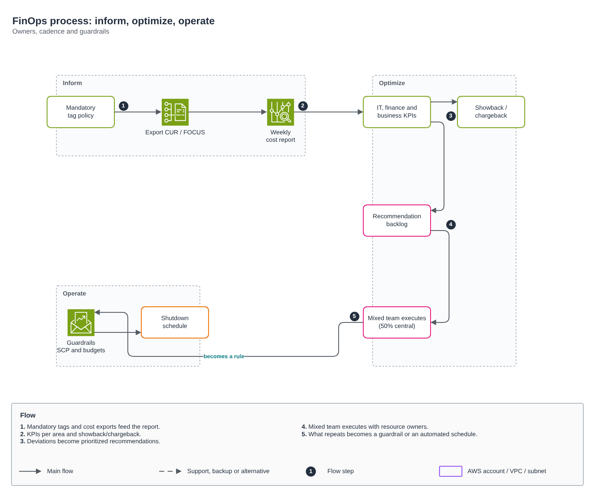

# FinOps process

[Português](README.md) · **English**

> CCoE, landing zone and platform of a telecom operator (2025-2026)

Inform, optimize and operate cycle, with owners, cadence and guardrails.

## Diagram

Editable source: [`desenho.drawio`](desenho.drawio), with pages in Portuguese and English. Open it in draw.io to browse.

The original drawing, anonymized, is kept in [`original/`](original) for reference.

### FinOps process: inform, optimize, operate



## Components found in the diagram

- Amazon VPC → module [`aws/vpc`](../../../../aws/vpc)
- AWS Organizations / SCP → module [`aws/organizations-scp`](../../../../aws/organizations-scp)

## Ready-made automation

The [`terraform/`](terraform) folder composes these catalog modules, in dependency order:

1. [`aws/cur-focus-export`](../../../../aws/cur-focus-export): Exportação de custos FOCUS 1.0
1. [`aws/finops-cost-report`](../../../../aws/finops-cost-report): Relatório diário de custos
1. [`aws/tag-compliance`](../../../../aws/tag-compliance): Conformidade de tags por evento
1. [`aws/instance-scheduler`](../../../../aws/instance-scheduler): Agendador FinOps de EC2/RDS

One module's outputs feed the next (for example `module.vpc.private_subnet_ids` and `module.kms_key.key_arn`), so there are no hard-coded IDs between layers.

### How to run

```bash
cd labs/arquiteturas/telecom/processo-finops/terraform
# adjust locals.tf (prefix, region, tags) and backend.tf (state bucket/account)
terraform init
terraform plan -out tfplan
terraform apply tfplan
```

Sample values (accounts, IDs, domains) are fictitious; replace them with your own before applying.
