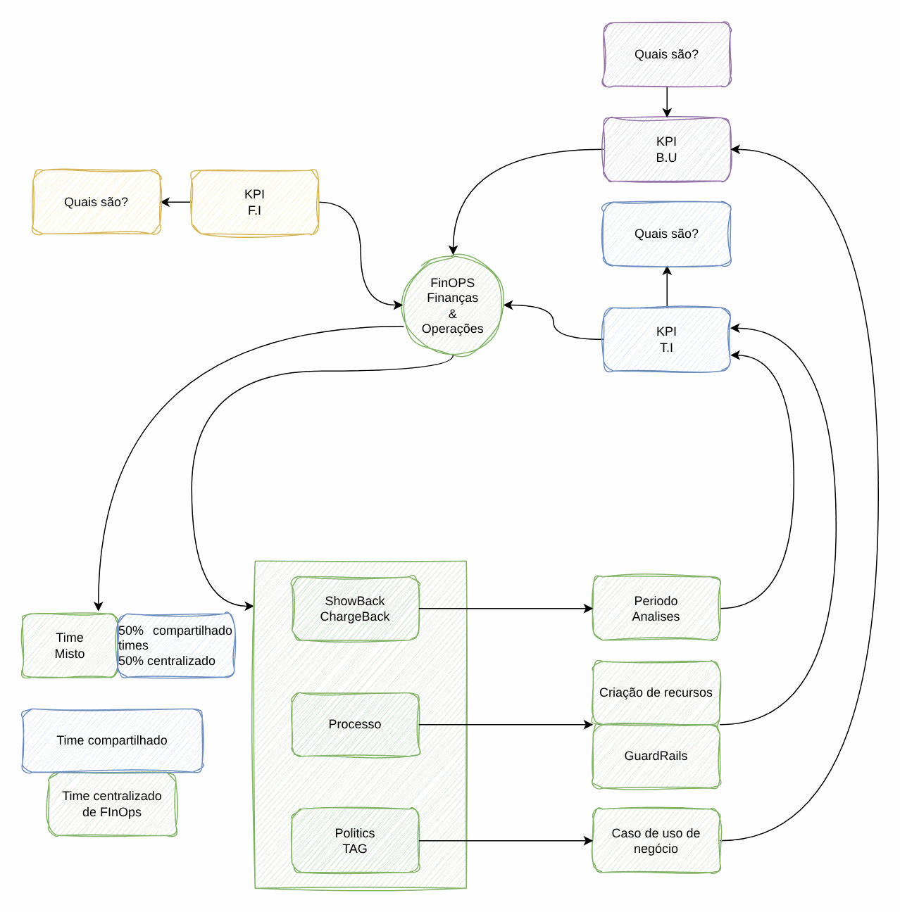

# Processo de FinOps

> CCoE, landing zone e plataforma de uma operadora de telecom (2025-2026)

Ciclo de FinOps: informar, otimizar e operar, com responsáveis e cadência.

## Desenho

Fonte editável: [`desenho.drawio`](desenho.drawio). Abra no draw.io para navegar pelas páginas.

### 1. Page-1



## Automação pronta

A pasta [`terraform/`](terraform) compõe estes módulos do catálogo, na ordem de dependência:

1. [`aws/cur-focus-export`](../../../../aws/cur-focus-export): Exportação de custos FOCUS 1.0
1. [`aws/finops-cost-report`](../../../../aws/finops-cost-report): Relatório diário de custos
1. [`aws/tag-compliance`](../../../../aws/tag-compliance): Conformidade de tags por evento
1. [`aws/instance-scheduler`](../../../../aws/instance-scheduler): Agendador FinOps de EC2/RDS

As saídas de um módulo alimentam o próximo (por exemplo, `module.vpc.private_subnet_ids` e `module.kms_key.key_arn`),
então não há IDs fixos entre camadas.

### Como executar

```bash
cd labs/arquiteturas/telecom/processo-finops/terraform
# ajuste locals.tf (prefixo, região, tags) e backend.tf (bucket/conta de state)
terraform init
terraform plan -out tfplan
terraform apply tfplan
```

Valores de exemplo (contas, IDs, domínios) são fictícios; troque pelos do seu ambiente antes do apply.
