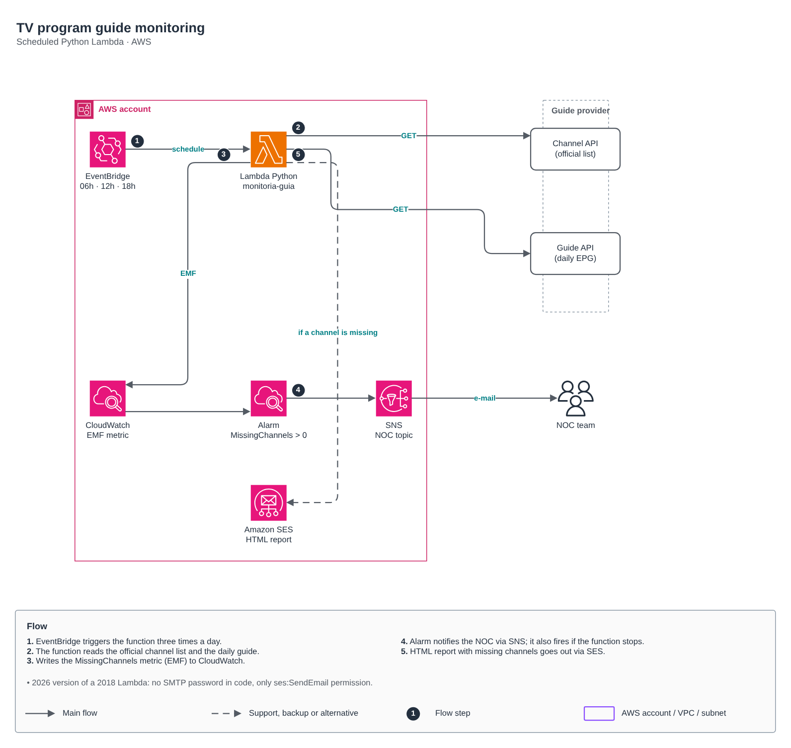

# TV program guide monitoring

🇺🇸 English · 🇧🇷 [Português](README.md)

A Python Lambda that checks, three times a day, whether every channel on the official list shows up in the day's program guide (EPG). When a channel is missing, the NOC gets an alarm and an email report.

## Flow

1. EventBridge triggers the function at 06:00, 12:00 and 18:00 (Brasília time).
2. The function reads the official channel list and the day's guide from the provider's APIs.
3. It writes the `CanaisAusentes` (missing channels) metric in EMF to CloudWatch, with no extra API call.
4. The alarm notifies the NOC through SNS when the metric goes above zero, and also when the function stops running (`treat_missing_data = breaching`).
5. An HTML report listing the missing channels is sent through Amazon SES.

This is the 2026 version of a Lambda I wrote in 2018: no SMTP password in code, no external dependencies (only `urllib` and `boto3`), only the `ses:SendEmail` permission, and URLs, sender and recipients in environment variables.

## Code

| File | Contents |
|---|---|
| [terraform/main.tf](terraform/main.tf) | SES identity, scheduled Lambda ([aws/lambda-function](../../aws/lambda-function) module), SNS topic ([aws/sns-topic](../../aws/sns-topic) module) and alarm |
| [terraform/locals.tf](terraform/locals.tf) | Environment values (fictitious endpoints) |
| [terraform/backend.tf](terraform/backend.tf) | Remote state |
| [terraform/src/app.py](terraform/src/app.py) | The function |
| [tests/test_app.py](tests/test_app.py) | pytest tests (`python3 -m pytest labs/monitoria-de-guia/tests`) |

## FinOps

Near-zero cost: 90 runs of a few seconds per month stay within the Lambda free tier; what costs is the CloudWatch alarm (US$ 0.10/month) and SES emails (US$ 0.10 per thousand).
