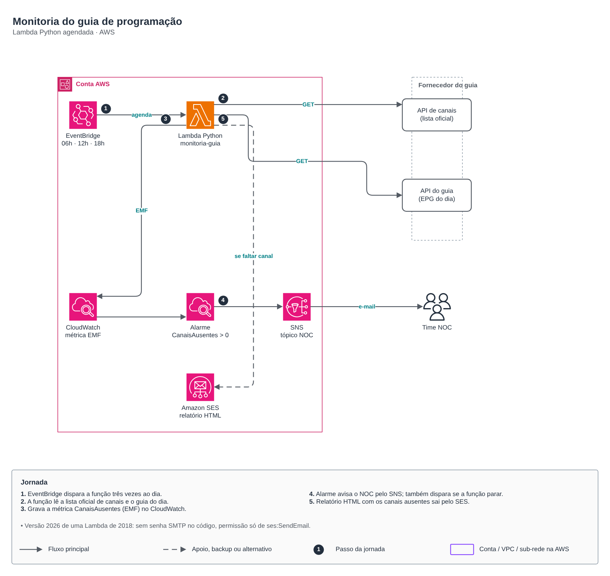

# Monitoria do guia de programação

🇧🇷 Português · 🇺🇸 [English](README.en.md)

Lambda em Python que confere, três vezes ao dia, se todos os canais da lista oficial aparecem no guia de programação (EPG) do dia. Quando falta canal, o NOC recebe um alarme e um relatório por e-mail.

## Jornada

1. O EventBridge dispara a função às 06h, 12h e 18h (Brasília).
2. A função lê a lista oficial de canais e o guia do dia nas APIs do fornecedor.
3. Grava a métrica `CanaisAusentes` em formato EMF no CloudWatch, sem chamada extra de API.
4. O alarme avisa o NOC pelo SNS quando a métrica passa de zero, e também quando a função para de rodar (`treat_missing_data = breaching`).
5. O relatório HTML com os canais ausentes sai pelo Amazon SES.

Esta é a versão 2026 de uma Lambda que escrevi em 2018: sem senha SMTP no código, sem dependências externas (só `urllib` e `boto3`), permissão apenas de `ses:SendEmail` e URLs, remetente e destinatários em variáveis de ambiente.

## Código

| Arquivo | Conteúdo |
|---|---|
| [terraform/main.tf](terraform/main.tf) | Identidade SES, Lambda agendada (módulo [aws/lambda-function](../../aws/lambda-function)), tópico SNS (módulo [aws/sns-topic](../../aws/sns-topic)) e alarme |
| [terraform/locals.tf](terraform/locals.tf) | Valores do ambiente (endpoints fictícios) |
| [terraform/backend.tf](terraform/backend.tf) | State remoto |
| [terraform/src/app.py](terraform/src/app.py) | A função |
| [tests/test_app.py](tests/test_app.py) | Testes com pytest (`python3 -m pytest labs/monitoria-de-guia/tests`) |

## FinOps

Custo próximo de zero: 90 execuções de poucos segundos por mês ficam dentro do free tier da Lambda; o que pesa é o alarme do CloudWatch (US$ 0,10/mês) e os e-mails do SES (US$ 0,10 por mil).
