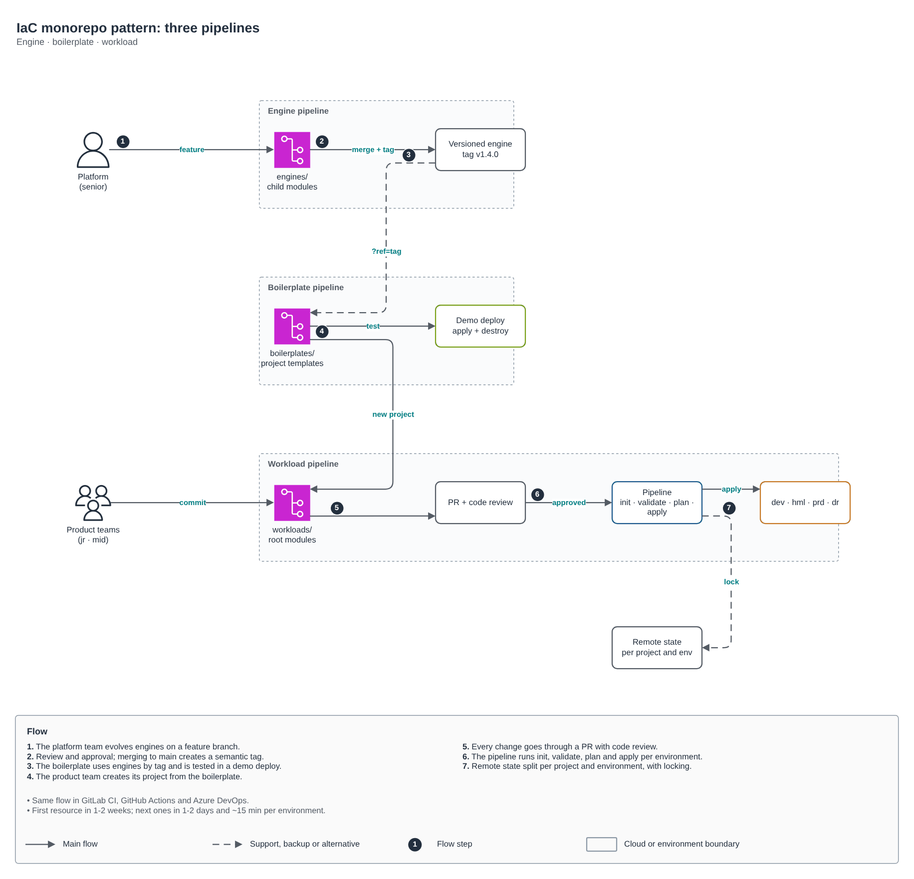
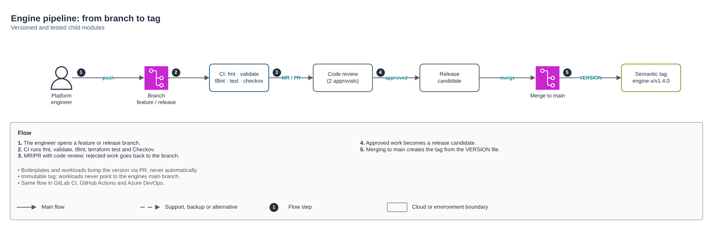
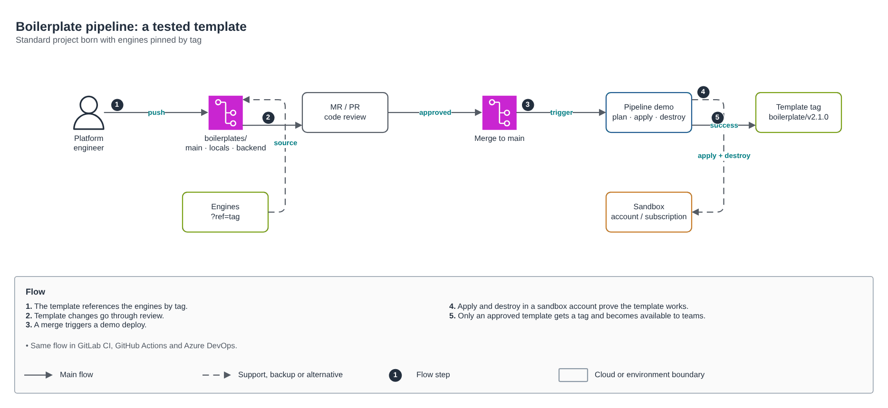
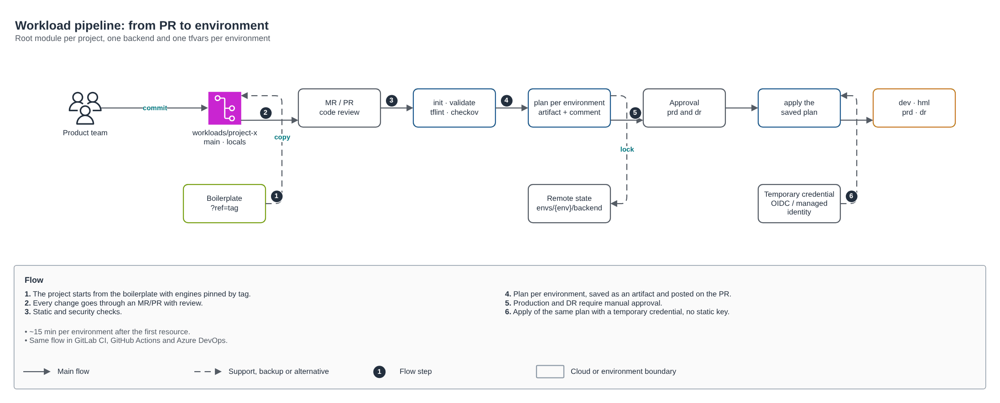

# IaC monorepo pattern: three pipelines

🇺🇸 English · 🇧🇷 [Português](README.md)

The pattern I use to organize Terraform in organizations of any size: a trunk-based monorepo with **three pipelines** (engine, boilerplate and workload), with the same flow in **GitLab CI, GitHub Actions and Azure DevOps**. It started in a cloud governance program on Azure and is now the base of all my IaC work.



| Pipeline | What it versions | Who changes it | What the pipeline does |
|---|---|---|---|
| **Engine** | Generic child modules (`engines/<cloud>/<resource>`) | Platform team (senior) | Checks, mandatory version bump and immutable tag `engines/<cloud>/<resource>/vX.Y.Z` |
| **Boilerplate** | Standard projects (`boilerplates/<pattern>`) | Platform team | Checks, demo deploy in a sandbox (apply + destroy) and tag |
| **Workload** | Each project's root modules (`workloads/<project>`) | Product teams (junior, mid) | Checks, per-environment plan posted on the PR and apply of the saved plan in dev → hml → prd → dr |

Outcome in the original program: a project's first resource in 1 to 2 weeks, the next ones in 1 to 2 days, and about 15 minutes of pipeline per environment.

## The pipelines



1. The platform engineer opens a feature or release branch.
2. CI runs `fmt`, `validate`, `tflint`, `terraform test` and Checkov, and requires a `VERSION` bump.
3. MR/PR with code review; rejected work goes back to the branch.
4. Approved work becomes a release candidate.
5. Merging to `main` creates the tag from `VERSION`. Tags are immutable: to publish again, bump the version.



The boilerplate references the engines by tag. On every merge, a demo deploy runs apply and destroy in a sandbox account or subscription; only a template that passes gets a tag and becomes available to teams.



A project starts by copying the boilerplate. Each environment has its own `envs/<env>/backend.hcl` and `envs/<env>/terraform.tfvars`, so state is split per project and environment. The plan is published as an artifact and a PR comment; hml, prd and dr require approval; apply uses the saved plan with a temporary OIDC credential (no client secret).

## Monorepo structure

```
iac/
├── engines/                      # child modules (main, variables, locals, outputs, VERSION, tests)
│   └── azure/resource-group/
├── boilerplates/                 # standard projects (provider, main, locals, variables, VERSION, envs/sandbox)
│   └── app-basica/
├── workloads/                    # root modules, one per project
│   └── projeto-exemplo/
│       ├── provider.tf  main.tf  locals.tf  variables.tf
│       └── envs/{dev,hml,prd,dr}/{backend.hcl,terraform.tfvars}
└── .pipelines/                   # the three pipelines + scripts
```

The skeleton in [`exemplo/`](exemplo) follows this structure and passes `terraform test`. Cross-project dependencies go through outputs and remote state, never hard-coded IDs.

## The three tools

| | Engine | Boilerplate | Workload |
|---|---|---|---|
| **GitLab CI** | [engine.gitlab-ci.yml](esteiras/gitlab/engine.gitlab-ci.yml) | [boilerplate.gitlab-ci.yml](esteiras/gitlab/boilerplate.gitlab-ci.yml) | [workload.gitlab-ci.yml](esteiras/gitlab/workload.gitlab-ci.yml) |
| **GitHub Actions** | [engine.yml](esteiras/github/engine.yml) | [boilerplate.yml](esteiras/github/boilerplate.yml) | [workload.yml](esteiras/github/workload.yml) |
| **Azure DevOps** | [engine.yml](esteiras/azure-devops/engine.yml) | [boilerplate.yml](esteiras/azure-devops/boilerplate.yml) | [workload.yml](esteiras/azure-devops/workload.yml) |

All three share the scripts in [`esteiras/scripts`](esteiras/scripts):

- `alterados.sh`: lists the engines, boilerplates or workloads changed since the base, so each pipeline only runs on what changed.
- `checks.sh`: `fmt`, `validate`, `tflint`, `terraform test` (when present) and Checkov.
- `tag.sh`: creates the `<folder>/v<VERSION>` tag and refuses to overwrite an existing one.

How to use it in your repository:

1. Copy `esteiras/scripts` to `.pipelines/scripts` and your tool's files to `.pipelines/` (GitLab: `.gitlab-ci.yml` at the root; GitHub: `.github/workflows/`; Azure DevOps: one pipeline per file).
2. Create the pipeline identity with a federated (OIDC) credential per environment: an App Registration on Azure, a role with `AssumeRoleWithWebIdentity` on AWS, or Workload Identity Federation on Google Cloud.
3. Require approval for the hml, prd and dr environments (protected environments in GitLab, required reviewers in GitHub, Approvals and checks in Azure DevOps).
4. Protect `main`: merges only through an approved MR/PR with a green pipeline.

The example uses Azure; for AWS or Google Cloud only the provider, the backend and the login change.

## Diagram

[desenho.drawio](desenho.drawio): pages 1 to 4 in Portuguese, 5 to 8 in English. Applied on Azure: [labs/arquiteturas/seguradora/governanca-de-nuvem](../labs/arquiteturas/seguradora/governanca-de-nuvem/README.en.md) and [governanca-iac-devops](../labs/arquiteturas/seguradora/governanca-iac-devops/README.en.md).
