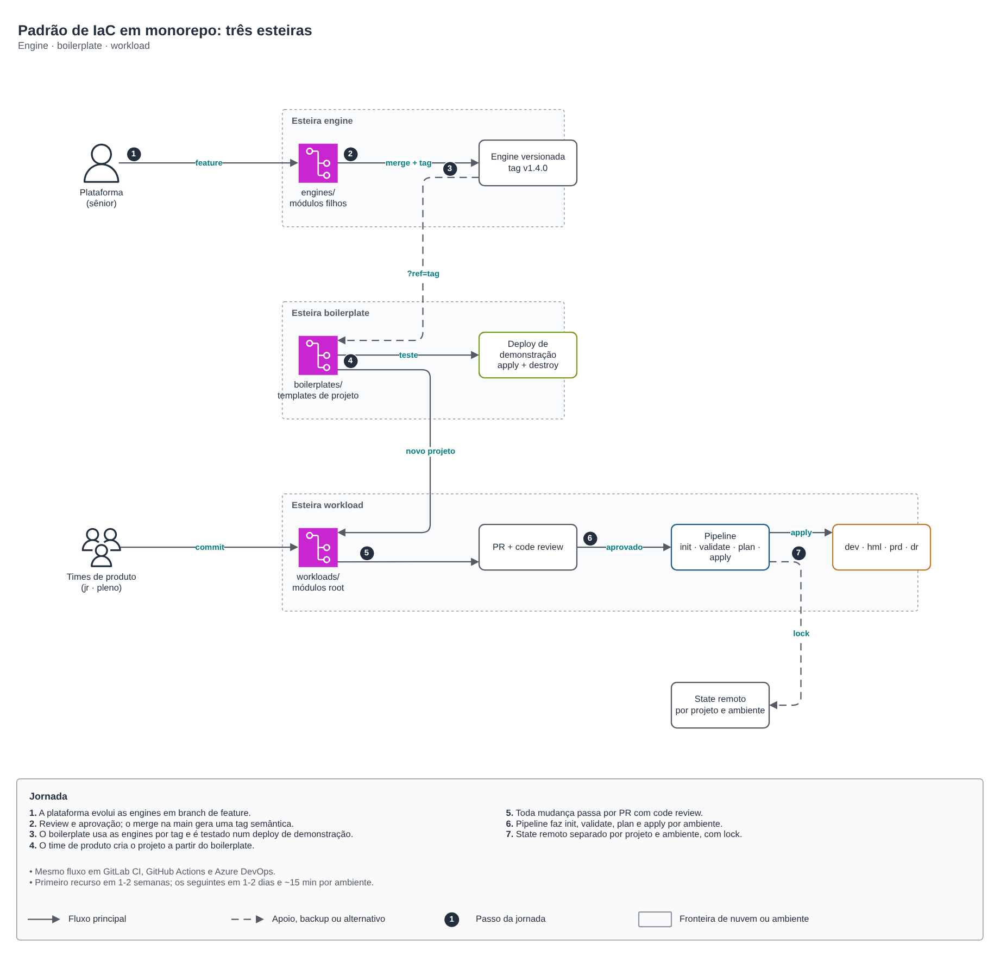
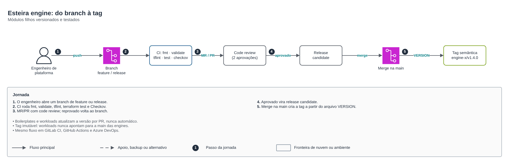
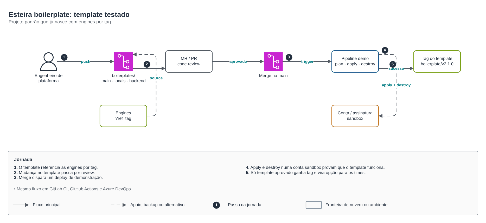
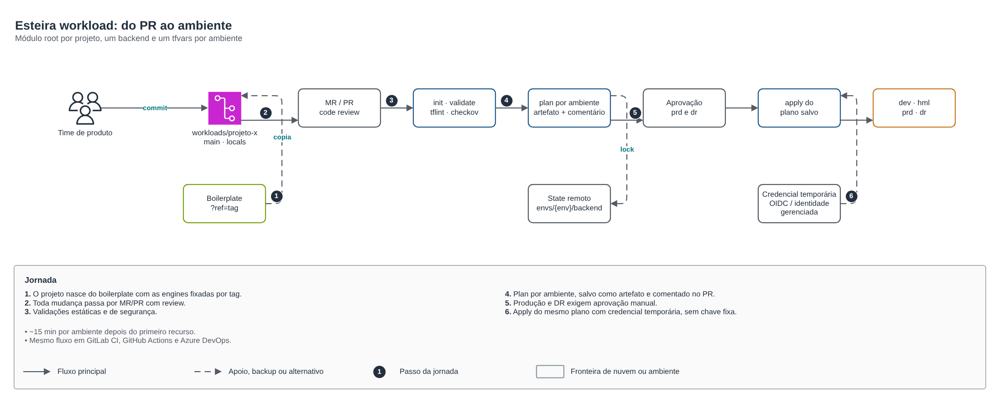

# Padrão de IaC em monorepo: três esteiras

🇧🇷 Português · 🇺🇸 [English](README.en.md)

Padrão que uso para organizar Terraform em organizações de qualquer tamanho: um monorepo trunk-based com **três esteiras** (engine, boilerplate e workload), o mesmo fluxo em **GitLab CI, GitHub Actions e Azure DevOps**. Nasceu num programa de governança de nuvem no Azure e hoje é a base de todo o meu trabalho com IaC.



| Esteira | O que versiona | Quem mexe | O que a esteira faz |
|---|---|---|---|
| **Engine** | Módulos filhos genéricos (`engines/<nuvem>/<recurso>`) | Plataforma (sênior) | Checagens, versão obrigatória e tag imutável `engines/<nuvem>/<recurso>/vX.Y.Z` |
| **Boilerplate** | Projetos padrão (`boilerplates/<padrão>`) | Plataforma | Checagens, deploy de demonstração na sandbox (apply + destroy) e tag |
| **Workload** | Módulos root de cada projeto (`workloads/<projeto>`) | Times de produto (jr, pleno) | Checagens, plan por ambiente comentado no PR e apply do plano salvo em dev → hml → prd → dr |

Resultado no programa original: o primeiro recurso de um projeto em 1 a 2 semanas, os seguintes em 1 a 2 dias, e cerca de 15 minutos de pipeline por ambiente.

## As esteiras



1. O engenheiro de plataforma abre um branch de feature ou release.
2. CI roda `fmt`, `validate`, `tflint`, `terraform test` e Checkov, e exige que o `VERSION` suba.
3. MR/PR com code review; reprovado volta ao branch.
4. Aprovado vira release candidate.
5. O merge na `main` cria a tag a partir do `VERSION`. Tag é imutável: para publicar de novo, sobe a versão.



O boilerplate referencia as engines por tag. A cada merge, um deploy de demonstração faz apply e destroy numa conta ou assinatura sandbox; só template que passa ganha tag e vira opção para os times.



O projeto nasce copiando o boilerplate. Cada ambiente tem o seu `envs/<ambiente>/backend.hcl` e `envs/<ambiente>/terraform.tfvars`, então o state é separado por projeto e ambiente. O plan sai como artefato e comentário no PR; hml, prd e dr exigem aprovação; o apply usa o plano salvo, com credencial temporária via OIDC (sem client secret).

## Estrutura do monorepo

```
iac/
├── engines/                      # módulos filhos (main, variables, locals, outputs, VERSION, tests)
│   └── azure/resource-group/
├── boilerplates/                 # projetos padrão (provider, main, locals, variables, VERSION, envs/sandbox)
│   └── app-basica/
├── workloads/                    # módulos root, um por projeto
│   └── projeto-exemplo/
│       ├── provider.tf  main.tf  locals.tf  variables.tf
│       └── envs/{dev,hml,prd,dr}/{backend.hcl,terraform.tfvars}
└── .pipelines/                   # as três esteiras + scripts
```

O esqueleto em [`exemplo/`](exemplo) segue essa estrutura e passa no `terraform test`. Dependência entre projetos vai por outputs e remote state, nunca por ID fixo.

## As três ferramentas

| | Engine | Boilerplate | Workload |
|---|---|---|---|
| **GitLab CI** | [engine.gitlab-ci.yml](esteiras/gitlab/engine.gitlab-ci.yml) | [boilerplate.gitlab-ci.yml](esteiras/gitlab/boilerplate.gitlab-ci.yml) | [workload.gitlab-ci.yml](esteiras/gitlab/workload.gitlab-ci.yml) |
| **GitHub Actions** | [engine.yml](esteiras/github/engine.yml) | [boilerplate.yml](esteiras/github/boilerplate.yml) | [workload.yml](esteiras/github/workload.yml) |
| **Azure DevOps** | [engine.yml](esteiras/azure-devops/engine.yml) | [boilerplate.yml](esteiras/azure-devops/boilerplate.yml) | [workload.yml](esteiras/azure-devops/workload.yml) |

Os três usam os mesmos scripts em [`esteiras/scripts`](esteiras/scripts):

- `alterados.sh`: lista as engines, boilerplates ou workloads alterados desde a base, para a esteira rodar só no que mudou.
- `checks.sh`: `fmt`, `validate`, `tflint`, `terraform test` (se houver) e Checkov.
- `tag.sh`: cria a tag `<pasta>/v<VERSION>` e recusa sobrescrever uma tag existente.

Como usar no seu repositório:

1. Copie `esteiras/scripts` para `.pipelines/scripts` e os arquivos da sua ferramenta para `.pipelines/` (GitLab: `.gitlab-ci.yml` na raiz; GitHub: `.github/workflows/`; Azure DevOps: um pipeline por arquivo).
2. Crie a identidade do pipeline com credencial federada (OIDC) por ambiente: App Registration no Azure, role com `AssumeRoleWithWebIdentity` na AWS ou Workload Identity Federation no Google Cloud.
3. Configure aprovação nos ambientes hml, prd e dr (environments protegidos no GitLab, required reviewers no GitHub, Approvals and checks no Azure DevOps).
4. Proteja a `main`: merge só por MR/PR com aprovação e pipeline verde.

O exemplo usa Azure; para AWS ou Google Cloud mudam só o provider, o backend e a forma de login.

## Desenho

[desenho.drawio](desenho.drawio): páginas 1 a 4 em português, 5 a 8 em inglês. Aplicação no Azure: [labs/arquiteturas/seguradora/governanca-de-nuvem](../labs/arquiteturas/seguradora/governanca-de-nuvem) e [governanca-iac-devops](../labs/arquiteturas/seguradora/governanca-iac-devops).
