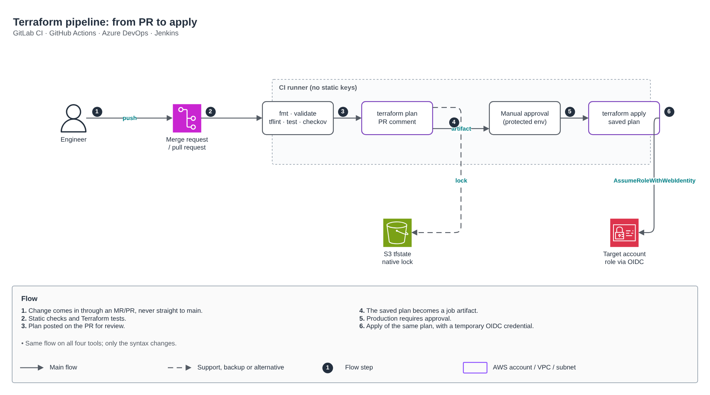
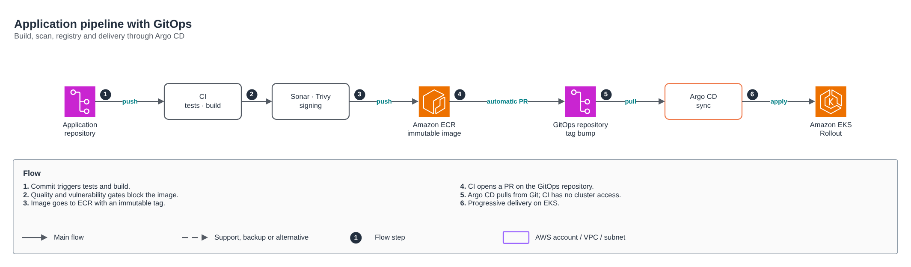

# CI/CD pipelines

🇺🇸 English · 🇧🇷 [Português](README.md)

The same delivery design in four tools: **GitLab CI, GitHub Actions, Azure DevOps and Jenkins**. The syntax changes, the flow is the same.

## Terraform pipeline: from PR to apply

1. Changes come in through a merge request or pull request, never straight to `main`.
2. `fmt`, `validate`, `tflint`, `terraform test` and Checkov block anything off-standard.
3. The `plan` is posted as a PR comment for review.
4. The saved plan becomes a job artifact.
5. Production requires manual approval in a protected environment.
6. `apply` runs the exact approved plan with a temporary credential via OIDC (`AssumeRoleWithWebIdentity`). No static keys in CI variables.

| Tool | File |
|---|---|
| GitLab CI | [terraform/gitlab-ci.yml](terraform/gitlab-ci.yml) |
| GitHub Actions | [terraform/github-actions.yml](terraform/github-actions.yml) |
| Azure DevOps | [terraform/azure-pipelines.yml](terraform/azure-pipelines.yml) |
| Jenkins | [terraform/Jenkinsfile](terraform/Jenkinsfile) |

## Application pipeline with GitOps

1. A commit triggers tests and build.
2. Sonar and Trivy block images with quality issues or vulnerabilities.
3. The image goes to ECR with an immutable tag.
4. CI opens a PR in the GitOps repository with the new tag.
5. Argo CD pulls from Git: CI has no access to the cluster.
6. Deployment to EKS is progressive (Argo Rollouts), as in [kubernetes/estrategias-de-deploy](../kubernetes/estrategias-de-deploy).

| Tool | File |
|---|---|
| GitLab CI | [aplicacao/gitlab-ci.yml](aplicacao/gitlab-ci.yml) |
| GitHub Actions | [aplicacao/github-actions.yml](aplicacao/github-actions.yml) |
| Azure DevOps | [aplicacao/azure-pipelines.yml](aplicacao/azure-pipelines.yml) |
| Jenkins | [aplicacao/Jenkinsfile](aplicacao/Jenkinsfile) |

Editable diagram: [desenho.drawio](desenho.drawio) (PT and EN pages).
