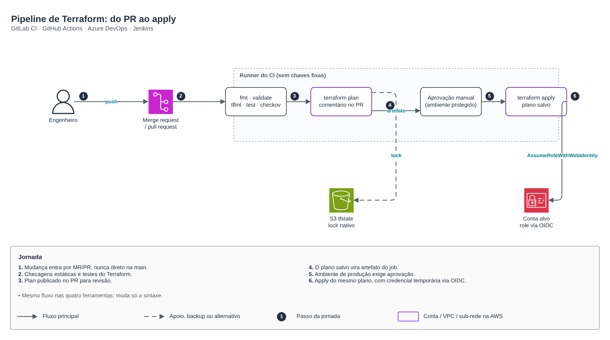
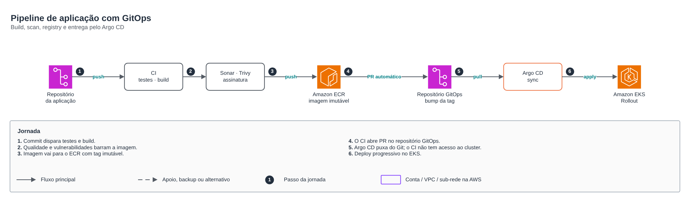

# Pipelines de CI/CD

🇧🇷 Português · 🇺🇸 [English](README.en.md)

O mesmo desenho de entrega em quatro ferramentas: **GitLab CI, GitHub Actions, Azure DevOps e Jenkins**. Muda a sintaxe, o fluxo é igual.

## Pipeline de Terraform: do PR ao apply

1. A mudança entra por merge request ou pull request, nunca direto na `main`.
2. `fmt`, `validate`, `tflint`, `terraform test` e Checkov barram o que está fora do padrão.
3. O `plan` é publicado como comentário no PR para revisão.
4. O plano salvo vira artefato do job.
5. Produção exige aprovação manual em ambiente protegido.
6. O `apply` usa exatamente o plano aprovado, com credencial temporária via OIDC (`AssumeRoleWithWebIdentity`). Nenhuma chave fixa em variável de CI.

| Ferramenta | Arquivo |
|---|---|
| GitLab CI | [terraform/gitlab-ci.yml](terraform/gitlab-ci.yml) |
| GitHub Actions | [terraform/github-actions.yml](terraform/github-actions.yml) |
| Azure DevOps | [terraform/azure-pipelines.yml](terraform/azure-pipelines.yml) |
| Jenkins | [terraform/Jenkinsfile](terraform/Jenkinsfile) |

## Pipeline de aplicação com GitOps

1. O commit dispara testes e build.
2. Sonar e Trivy barram a imagem com problema de qualidade ou vulnerabilidade.
3. A imagem vai para o ECR com tag imutável.
4. O CI abre um PR no repositório GitOps com a nova tag.
5. O Argo CD puxa do Git: o CI não tem acesso ao cluster.
6. O deploy no EKS é progressivo (Argo Rollouts), como em [kubernetes/estrategias-de-deploy](../kubernetes/estrategias-de-deploy).

| Ferramenta | Arquivo |
|---|---|
| GitLab CI | [aplicacao/gitlab-ci.yml](aplicacao/gitlab-ci.yml) |
| GitHub Actions | [aplicacao/github-actions.yml](aplicacao/github-actions.yml) |
| Azure DevOps | [aplicacao/azure-pipelines.yml](aplicacao/azure-pipelines.yml) |
| Jenkins | [aplicacao/Jenkinsfile](aplicacao/Jenkinsfile) |

Desenho editável: [desenho.drawio](desenho.drawio) (páginas em PT e EN).
